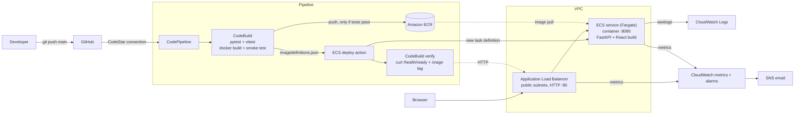

# AWS-Native CI/CD Automation Platform — DevOps Deployment Dashboard

A portfolio-grade project that ships a containerized **React + FastAPI** application through a fully
AWS-native pipeline: **GitHub → CodePipeline → CodeBuild (tests + Docker build) → ECR → ECS Fargate → ALB**,
with CloudWatch logs, metrics and alarms, all provisioned with **Terraform**.

> **Honesty note.** Everything in this repository is generated code. See
> [`docs/validation-status.md`](docs/validation-status.md) for exactly what was executed and verified
> (backend/frontend tests, production build, Gunicorn run) and what was **not** (Docker build, Terraform
> `plan/apply`, anything on AWS). You must run those steps yourself; this repo never claims AWS resources exist
> until you create them. **Nothing here deploys or spends money unless you run `terraform apply`.**

---

## Table of contents
1. [Objective & features](#1-objective--features)
2. [Architecture](#2-architecture)
3. [Technology stack](#3-technology-stack)
4. [Repository layout](#4-repository-layout)
5. [Prerequisites](#5-prerequisites)
6. [Local development (no AWS needed)](#6-local-development-no-aws-needed)
7. [Docker: build, run, inspect, clean up](#7-docker-build-run-inspect-clean-up)
8. [GitHub repository setup](#8-github-repository-setup)
9. [AWS deployment — exact order](#9-aws-deployment--exact-order)
10. [Verify the deployment](#10-verify-the-deployment)
11. [Prove CI blocks bad code](#11-prove-ci-blocks-bad-code)
12. [Monitoring & troubleshooting](#12-monitoring--troubleshooting)
13. [Rollback](#13-rollback)
14. [Cleanup](#14-cleanup)
15. [Cost warnings](#15-cost-warnings)
16. [Security considerations](#16-security-considerations)
17. [Documentation index](#17-documentation-index)

---


### Access the Website: http://localhost:8080/

## 1. Objective & features

**Objective:** demonstrate end-to-end DevOps skills — CI, CD, containers, IaC, observability, least-privilege
IAM, rollback, and cost awareness — on a real application you can open in a browser.

| Area | What you get |
|------|--------------|
| App | React/TypeScript dashboard served by FastAPI from one container; no database, no paid APIs |
| Honest data | Every number is a real API response. Missing metadata shows **Unavailable**; no fake pipeline status |
| CI | CodeBuild runs pytest + vitest + TypeScript check, builds the image, smoke-tests the container, pushes to ECR **only if all pass** |
| CD | Native CodePipeline **ECS deploy action** with `imagedefinitions.json`; ECS **deployment circuit breaker with automatic rollback** |
| Verification | A 4th pipeline stage polls the live ALB URL until the *new* image tag answers `/health/ready` |
| IaC | Terraform modules: network, ECR, ALB, ECS, CI/CD, monitoring; 3 network cost profiles |
| Observability | JSON logs in CloudWatch, alarms (CPU, memory, no healthy targets, 5xx), failure notifications (SNS), dashboard |
| Recovery | `scripts/rollback.*` redeploys any retained ECR image and verifies it |

## 2. Architecture



Read the design decisions (network cost profiles, bootstrap order, why Terraform ignores the task
definition) in [`docs/architecture.md`](docs/architecture.md).

## 3. Technology stack

React 18 · Vite 5 · TypeScript · Vitest · FastAPI · Pydantic v2 · Pytest · Gunicorn + Uvicorn workers ·
Docker (multi-stage, non-root) · Terraform (AWS provider ~> 5.70) · CodePipeline · CodeBuild · ECR ·
ECS Fargate · ALB · CloudWatch · SNS · IAM · GitHub.

## 4. Repository layout

```
.
├── VERSION                    # single source of truth for the app version
├── backend/app/               # FastAPI (config, routers, schemas, logging)
├── backend/tests/             # pytest
├── frontend/src, tests/       # React + TS, vitest
├── Dockerfile  .dockerignore
├── buildspec.yml              # CodeBuild: test -> build -> smoke test -> push -> imagedefinitions.json
├── buildspec-verify.yml       # CodeBuild: post-deploy HTTP verification
├── infrastructure/
│   ├── bootstrap/             # OPTIONAL remote-state bucket
│   ├── main/                  # root module (run terraform here)
│   └── modules/               # network, ecr, alb, ecs, cicd, monitoring
├── scripts/                   # *.ps1 (Windows) and *.sh (Linux/macOS)
└── docs/                      # architecture, aws-setup, pipeline, monitoring, troubleshooting, security,
                               # cost-and-cleanup, rollback, interview-questions, validation-status
```

## 5. Prerequisites

| Tool | Version | Check (PowerShell) |
|------|---------|--------------------|
| Git | any recent | `git --version` |
| Python | 3.12 | `python --version` |
| Node.js | 20 LTS or newer | `node --version` |
| Docker Desktop | running | `docker version` |
| AWS CLI | v2 | `aws --version` |
| Terraform | ≥ 1.6 | `terraform version` |

AWS account: use an IAM Identity Center user or IAM user — **never the root user** — with permission to create
the resources above (for a personal sandbox account, an admin-level user is the simplest *for you*; the
roles Terraform creates for the pipeline are least-privilege). Configure credentials and confirm:

```powershell
aws configure sso          # or: aws configure
aws sts get-caller-identity   # must print the account you intend to use
```

Pick **one region** (e.g. `us-east-1`, or `ap-south-1` for India). Use the same region everywhere.

## 6. Local development (no AWS needed)

**Run all tests** (Windows PowerShell):
```powershell
.\scripts\local-test.ps1
```
Linux/macOS: `bash scripts/local-test.sh`. Expected ending: `All checks passed.`
(Reference run in this repo's build environment: backend 21 passed, frontend 10 passed.)

**Run the app in development mode** (two terminals):
```powershell
# Terminal 1 - backend on :8080
cd backend
.\.venv\Scripts\python.exe -m uvicorn app.main:app --reload --port 8080
# Terminal 2 - frontend dev server on :5173 (proxies /api and /health to :8080)
cd frontend
npm run dev
```
Open http://localhost:5173.

**Run like production (single process serving the built UI):**
```powershell
cd frontend; npm run build; cd ..
cd backend; $env:APP_REQUIRE_FRONTEND="true"
.\.venv\Scripts\python.exe -m uvicorn app.main:app --port 8080
```
Open http://localhost:8080. (Linux/macOS: `APP_REQUIRE_FRONTEND=true backend/.venv/bin/python -m uvicorn --app-dir backend app.main:app --port 8080`.)

## 7. Docker: build, run, inspect, clean up

```powershell
docker build -t devops-dashboard:local --build-arg APP_IMAGE_TAG=local .   # build (multi-stage)
docker run -d --name dashboard -p 8080:8080 devops-dashboard:local       # run
curl.exe http://localhost:8080/health/ready                               # expect {"status":"ready",...}
curl.exe http://localhost:8080/api/info                                   # shows image_tag "local"
docker logs dashboard                                                     # JSON log lines
docker ps                                                                 # STATUS should become "healthy"
docker exec dashboard id                                                  # uid=10001(app): non-root
docker image inspect devops-dashboard:local --format "{{.Size}}"          # size in bytes
docker rm -f dashboard                                                    # stop + remove container
docker image rm devops-dashboard:local                                    # remove image
```
Or run everything in one step: `.\scripts\local-test.ps1 -WithDocker`.

## 8. GitHub repository setup

1. Create an **empty** repository on GitHub (e.g. `aws-native-cicd-dashboard`, default branch `main`).
2. Push this project:
```powershell
git init -b main
git add .
git status          # confirm no .env, terraform.tfvars or *.tfstate files are listed
git commit -m "Initial commit"
git remote add origin https://github.com/YOUR-USER/aws-native-cicd-dashboard.git
git push -u origin main
```

## 9. AWS deployment — exact order

The first deployment is split into phases because **ECS needs an image that already exists in ECR**, and the
pipeline's ECS deploy action needs an **existing service**. Details and reasoning: [`docs/architecture.md`](docs/architecture.md#bootstrap-sequence).

| Phase | What | Command |
|-------|------|---------|
| A | Foundation: VPC, ECR, ALB, ECS cluster, IAM, logs, artifact bucket, CodeBuild projects, GitHub connection, dashboard | `deploy.ps1 -Phase A` |
| manual | Authorize the GitHub connection (one-time, in console) | see below |
| B | Test, build, push the first image to ECR | `bootstrap.ps1` |
| C | ECS task definition + service, pipeline, alarms | `deploy.ps1 -Phase C -ImageTag <tag>` |
| D | Verify, then push a change to watch automatic deployment | section 10 |

**Step 1 — configure variables**
```powershell
cd infrastructure\main
Copy-Item terraform.tfvars.example terraform.tfvars
notepad terraform.tfvars    # set aws_region, github_full_repository_id (YOUR-USER/repo), optional alarm_email
cd ..\..
```
**Step 2 — Phase A (review the plan, then type `yes`)**
```powershell
.\scripts\deploy.ps1 -Phase A
```
The script runs `terraform init`, `fmt -check`, `validate`, `plan` and **asks for confirmation** before `apply`.
Expected: a plan listing the resources to add (read it; count varies with `network_profile`), then
`Apply complete!` and outputs such as `ecr_repository_name`, `application_url`, `github_connection_status = "PENDING"`.
The application URL will return **503** until Phase C — that is expected (no service yet).

**Step 3 — authorize the GitHub connection (manual, one-time)**
1. AWS Console → **Developer Tools** → **Settings** → **Connections** (same region as your project).
2. Open the connection named `devops-dashboard-dev-github` (status **Pending**).
3. Click **Update pending connection** → in the pop-up choose **Install a new app** (or select an existing installation) → sign in to GitHub → authorize **AWS Connector for GitHub** and grant it access to your repository → **Connect**.
4. Expected result: status **Available**. Check: `aws codestar-connections list-connections --region <region> --query "Connections[].[Name,ConnectionStatus]" --output table`

**Step 4 — Phase B: first image**
```powershell
terraform -chdir=infrastructure/main output -raw ecr_repository_name     # copy the name
.\scripts\bootstrap.ps1 -Region <region> -Repository <ecr_repository_name>
```
This runs the tests, builds a `linux/amd64` image and pushes it tagged with the short Git SHA
(e.g. `a1b2c3d`). It prints that tag at the end. *(Requires at least one commit and Docker running.)*

**Step 5 — Phase C: service + pipeline**
```powershell
.\scripts\deploy.ps1 -Phase C -ImageTag a1b2c3d     # use the tag printed by bootstrap
```
Review the plan, type `yes`. Creating the pipeline starts a first execution automatically.

**Step 6 — find the application URL**
```powershell
terraform -chdir=infrastructure/main output application_url
```
Allow 2–5 minutes for the task to start and the target to become healthy.

## 10. Verify the deployment

```powershell
$url = terraform -chdir=infrastructure/main output -raw application_url
.\scripts\verify-deployment.ps1 -BaseUrl $url -ExpectedImageTag a1b2c3d   # prints VERIFIED: ... when it works
```
Inspect each health layer separately (they mean different things — see [`docs/monitoring.md`](docs/monitoring.md)):
```powershell
$r = "<region>"; $c = terraform -chdir=infrastructure/main output -raw ecs_cluster_name
$s = terraform -chdir=infrastructure/main output -raw ecs_service_name
aws ecs describe-services --region $r --cluster $c --services $s --query "services[0].{status:status,running:runningCount,desired:desiredCount,rollout:deployments[0].rolloutState}"
aws elbv2 describe-target-groups --region $r --names devops-dashboard-dev-tg --query "TargetGroups[0].TargetGroupArn" --output text
aws elbv2 describe-target-health --region $r --target-group-arn <arn-from-previous-command>
aws logs tail /ecs/devops-dashboard-dev --region $r --since 15m
aws codepipeline get-pipeline-state --region $r --name devops-dashboard-dev-pipeline --query "stageStates[].[stageName,latestExecution.status]" --output table
```
**Prove automatic deployment (acceptance criteria 7–9):** edit `VERSION` to `1.0.1`, then
```powershell
git add VERSION; git commit -m "Release 1.0.1"; git push
```
Watch **CodePipeline → devops-dashboard-dev-pipeline**: Source → BuildAndTest → Deploy → Verify all turn green;
refresh the dashboard: version `1.0.1` with the new commit.

## 11. Prove CI blocks bad code

```powershell
@'
def test_deliberate_failure_to_prove_ci_blocks_deploy():
    assert False, "Deliberate failure: the pipeline must stop before Deploy"
'@ | Set-Content backend\tests\test_deliberate_failure.py
git add backend\tests\test_deliberate_failure.py
git commit -m "DEMO: deliberately failing test"
git push
```
Expected in the console: **BuildAndTest = Failed**, **Deploy = not started**, **Verify = not started**, no new image
in ECR for that SHA, and the site keeps serving the previous version. (The CodeBuild *Reports* tab shows the failing test.)
Restore with: `git revert HEAD --no-edit; git push`.
Details: [`docs/pipeline.md`](docs/pipeline.md#proving-that-failed-ci-blocks-deployment).

## 12. Monitoring & troubleshooting

* Logs: CloudWatch Logs group `/ecs/<prefix>` (app), `/aws/codebuild/<prefix>-build` and `-verify` (pipeline).
* Dashboard: CloudWatch → Dashboards → `<prefix>-overview`. Alarms: CPU, memory, no healthy targets, unhealthy targets, 5xx.
* Set `alarm_email` in tfvars to receive alarm and pipeline-failure emails (confirm the SNS subscription email).
* Step-by-step diagnosis for failed builds, image pull errors, unhealthy targets, stopped tasks and failed
  deployments: [`docs/troubleshooting.md`](docs/troubleshooting.md).

## 13. Rollback

Automatic: the ECS circuit breaker rolls a *failing-to-start* deployment back by itself.
Manual (bad-but-healthy release): 
```powershell
aws ecr describe-images --region <region> --repository-name <repo> --query "sort_by(imageDetails,&imagePushedAt)[].[imageTags[0],imagePushedAt]" --output table
.\scripts\rollback.ps1 -Region <region> -Cluster <cluster> -Service <service> -Repository <repo> -ImageTag <old-tag> -BaseUrl $url
```
Then **also** `git revert` the bad commit, otherwise the next push redeploys the bad code. Full procedure:
[`docs/rollback.md`](docs/rollback.md).

## 14. Cleanup

```powershell
.\scripts\cleanup.ps1 -Region <region> -ProjectPrefix devops-dashboard-dev
```
Confirms twice, runs `terraform destroy`, then lists anything that might still be billing. See
[`docs/cost-and-cleanup.md`](docs/cost-and-cleanup.md).

## 15. Cost warnings

**This stack is NOT free.** The ALB and Fargate bill by the hour while they exist, and a NAT Gateway or
interface VPC endpoints (optional profiles) cost more. Rough planning figures (us-east-1, verify on the AWS
pricing pages): ALB ≈ US$16–22/month, one 0.25 vCPU/0.5 GB Fargate task ≈ US$9/month, public IPv4 addresses
≈ US$3.65/month each. **Destroy the stack when you are not demonstrating it.** A budget alert warns you; it
does **not** stop spending. Full breakdown and Free Tier checklist: [`docs/cost-and-cleanup.md`](docs/cost-and-cleanup.md).

## 16. Security considerations

Separate least-privilege roles for CodePipeline, CodeBuild (build/verify), ECS execution and ECS task; ALB is the
only public entry; tasks accept traffic only from the ALB security group; no SSH; encrypted S3/ECR/logs; ECR scan
on push and immutable tags; non-root container; no secrets in code, images or logs. **The learning setup uses
plain HTTP** — use HTTPS (ACM certificate + 443 listener + domain) for anything real. Terraform state can contain
sensitive data: keep it out of Git and consider the remote backend. Details: [`docs/security.md`](docs/security.md).

## 17. Documentation index

[`architecture.md`](docs/architecture.md) · [`aws-setup.md`](docs/aws-setup.md) · [`pipeline.md`](docs/pipeline.md) ·
[`monitoring.md`](docs/monitoring.md) · [`troubleshooting.md`](docs/troubleshooting.md) ·
[`security.md`](docs/security.md) · [`cost-and-cleanup.md`](docs/cost-and-cleanup.md) ·
[`rollback.md`](docs/rollback.md) · [`interview-questions.md`](docs/interview-questions.md) ·
[`validation-status.md`](docs/validation-status.md)
